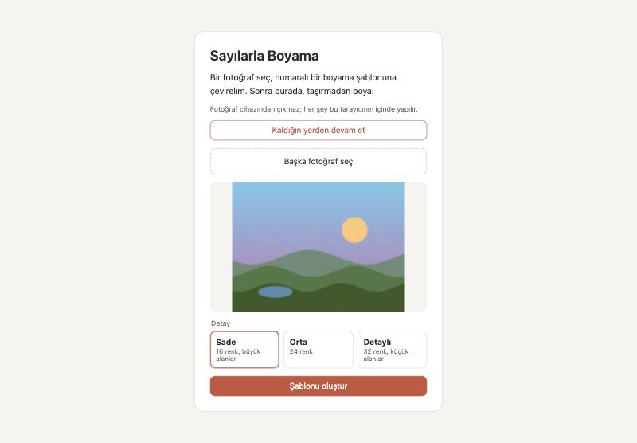
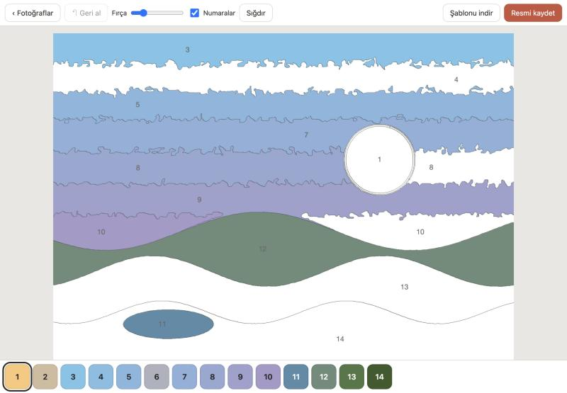

# Sayılarla Boyama

[](https://github.com/kaanyildiz14/sayilarla-boyama/actions/workflows/ci.yml)


Galerideki bir fotoğrafı numaralı boyama şablonuna çeviren ve boyamayı da kendi içinde yaptıran web uygulaması. iPad'de Safari'den, bilgisayarda herhangi bir tarayıcıdan açılır.

**Uygulamayı aç:** https://kaanyildiz14.github.io/sayilarla-boyama/

| Fotoğraf seç | Boya |
|---|---|
|  |  |

## Ne yapar?

- **Şablon çıkarır:** Fotoğrafı 16, 24 ya da 32 renge indirir, aynı renkteki alanları bölgelere ayırır, sınırları çizer ve her bölgeye renk numarasını yazar.
- **Taşırmadan boyatır:** Fırça darbesi başladığı bölgenin dışına çıkamaz. Fırça ne kadar kalın olursa olsun boya kenara taşmaz.
- **iPad'e uygundur:** Apple Pencil ile boyanır, iki parmakla yakınlaştırılır ve kaydırılır. Kalem kullanıldıktan sonra parmak sadece kaydırma yapar, böylece avuç içi yanlışlıkla boya bırakmaz.
- **Kaldığın yerden devam eder:** Boyama otomatik kaydedilir; sayfayı kapatıp açınca devam edilir.
- **Kaydeder:** Bitmiş resim ya da boş şablon (altında renk kartelasıyla) PNG olarak galeriye kaydedilir.

Fotoğraf hiçbir sunucuya gönderilmez. Bütün işlem tarayıcının içinde yapılır, kayıt da tarayıcının kendi veritabanında (IndexedDB) durur.

## Nasıl çalışır?

1. Fotoğraf uzun kenarı 1800 piksel olacak şekilde ölçeklenir ve hafifçe bulanıklaştırılır.
2. Renkler CIELAB uzayında **k-means** ile gruplanır (Lab, gözün algıladığı renk farkına RGB'den daha yakındır).
3. Çoğunluk filtresi tek tük piksellik lekeleri temizler.
4. Alanı küçük ya da numara sığmayacak kadar ince bölgeler, en uzun sınırı paylaştıkları komşuya katılır.
5. Her bölgede sınıra en uzak nokta (uzaklık dönüşümü ile) bulunur ve numara oraya yazılır.
6. Boyarken fırça izi ayrı bir tuvale çizilir ve bölgenin maskesiyle kesilir (`destination-in`).

Ayrıntılar: [docs/mimari.md](docs/mimari.md)

## Geliştirme

```bash
npm install
npm run dev      # http://localhost:5173
npm test         # birim testleri (Vitest)
npm run build    # tür denetimi + üretim derlemesi
```

Görüntü işleme kodu `src/islem/` klasöründedir ve tarayıcıya bağlı değildir; testler doğrudan bu modülleri sınar.

## Lisans

[MIT](LICENSE)
