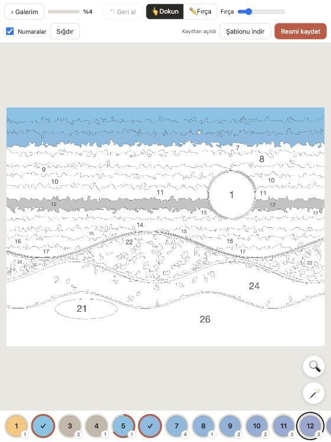
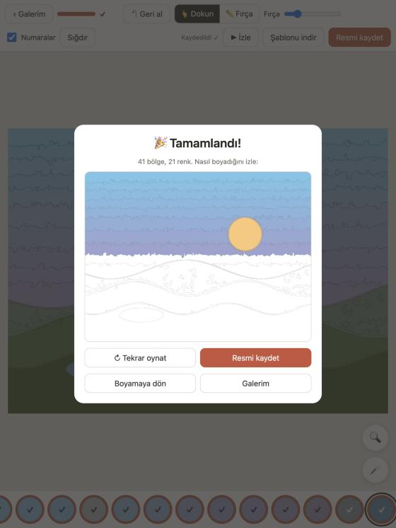
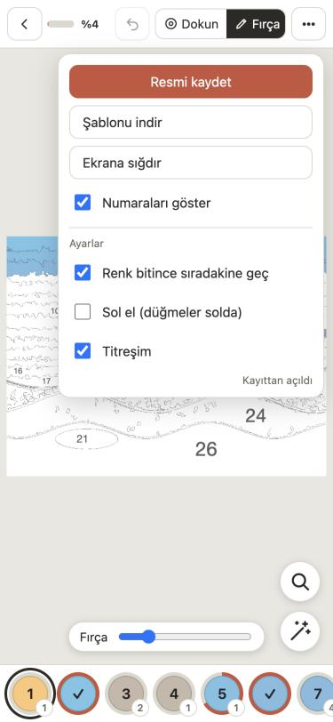

# Sayılarla Boyama

[](https://github.com/kaanyildiz14/sayilarla-boyama/actions/workflows/ci.yml)


Galerideki bir fotoğrafı numaralı boyama şablonuna çeviren ve boyamayı da kendi içinde yaptıran web uygulaması. iPad'de Safari'den, bilgisayarda herhangi bir tarayıcıdan açılır.

**Uygulamayı aç:** https://kaanyildiz14.github.io/sayilarla-boyama/

| Oyun (tablet) | Tamamlandı | Telefon |
|---|---|---|
|  |  |  |

## Ne yapar?

- **Şablon çıkarır:** Fotoğrafı 16, 24 ya da 32 renge indirir, aynı renkteki alanları bölgelere ayırır, sınırları çizer ve her bölgeye renk numarasını yazar.
- **İki araç:** *Dokun* ile bölgeye dokununca tamamı doğru renkle dolar (yanlış renkte dolmaz, hangi numara olduğunu söyler). *Fırça* ile taşırmadan elle boyanır: darbe başladığı bölgenin dışına çıkamaz. Apple Pencil her zaman fırça gibi boyar.
- **Oyun:** Üstte yüzde kaç bittiği, kartelada her rengin ilerleme halkası ve kalan bölge sayısı. Bir renk bitince ✓ ve sıradaki renge geçilir; bölgenin %90'ı doğru renkle boyanınca bitmiş sayılır. Resim bitince tebrik.
- **Yardımcılar:** Seçili rengin boş bölgeleri koyulaşır. 🔍 *Bulucu* o rengin kalan en yakın bölgesine götürüp yanıp söndürür; 🪄 *Sihirli değnek* ekranda görünen boş bölgelerini tek seferde boyar. Numaralar yakınlaştıkça belirir, bölge bitince kaybolur.
- **Ödül anı:** Resim bitince kutlama ekranı açılır ve resmin baştan sona nasıl boyandığı hızlandırılmış olarak oynatılır. Bitmiş resimler *▶ İzle* ile sonradan da izlenebilir.
- **iPad'e uygundur:** Apple Pencil ile boyanır, iki parmakla yakınlaştırılır ve kaydırılır. Kalem kullanıldıktan sonra parmak sadece kaydırma yapar, böylece avuç içi yanlışlıkla boya bırakmaz.
- **Galerim:** Bütün resimlerin kart kart durur; her kartta resmin o anki hali görünür. Adı değiştirilebilir, silinebilir.
- **Telefon ve tablet:** Dar ekranda tek satır araç çubuğu ve menü; sol el modu. Ana ekrana eklenince uygulama gibi açılır ve **internet olmadan çalışır**.
- **Kaldığın yerden devam eder:** Boyama otomatik kaydedilir; sayfayı kapatıp açınca devam edilir.
- **Kaydeder:** Bitmiş resim ya da boş şablon (altında renk kartelasıyla) PNG olarak galeriye kaydedilir.

Fotoğraf hiçbir sunucuya gönderilmez. Bütün işlem tarayıcının içinde yapılır, kayıt da tarayıcının kendi veritabanında (IndexedDB) durur.

## Nasıl çalışır?

1. Fotoğraf uzun kenarı 1800 piksel olacak şekilde ölçeklenir ve hafifçe bulanıklaştırılır.
2. Renkler CIELAB uzayında **k-means** ile gruplanır (Lab, gözün algıladığı renk farkına RGB'den daha yakındır).
3. Çoğunluk filtresi tek tük piksellik lekeleri temizler.
4. Alanı küçük ya da numara sığmayacak kadar ince bölgeler, en uzun sınırı paylaştıkları komşuya katılır.
5. Her bölgede sınıra en uzak nokta (uzaklık dönüşümü ile) bulunur ve numara oraya yazılır.
6. Boyarken fırça izi ayrı bir tuvale çizilir ve bölgenin maskesiyle kesilir (`destination-in`).

Ayrıntılar: [docs/mimari.md](docs/mimari.md) · Sürümler: [CHANGELOG.md](CHANGELOG.md) · Oyuna dönüşüm planı: [docs/oyun-plani.md](docs/oyun-plani.md)

## Geliştirme

```bash
npm install
npm run dev      # http://localhost:5173
npm test         # birim testleri (Vitest)
npm run test:e2e # uçtan uca testler (Playwright: iPad, iPhone, masaüstü)
npm run build    # tür denetimi + üretim derlemesi
```

Görüntü işleme kodu `src/islem/` klasöründedir ve tarayıcıya bağlı değildir; testler doğrudan bu modülleri sınar.

## Lisans

[MIT](LICENSE)
